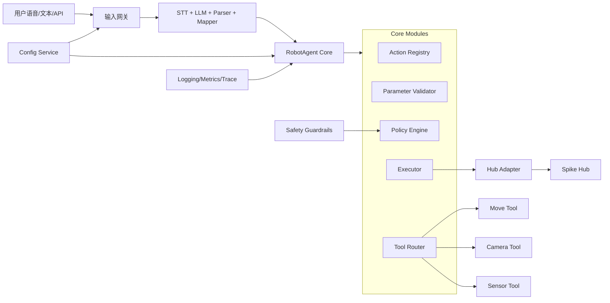
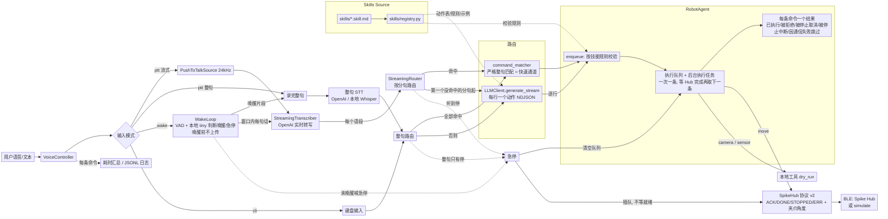
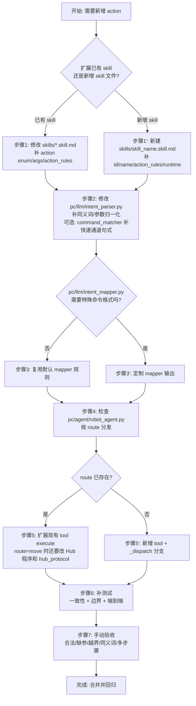

# Voice Robot

一个面向 LEGO Spike Hub 的语音/文本机器人控制项目，用于教学演示。  
主链路是：用户输入 -> 本地快速通道或 LLM -> RobotAgent（校验 + 执行队列）-> Spike Hub。

最终目标是在 WRO Starter 2025 场地上，用三脚架摄像头获取小车和物体的位置，让小车根据一句自然语言（例如"把黄色小人送回家"）自己拆解任务并完成。开发路线和进度见 [docs/roadmap.md](docs/roadmap.md)。

## Quickstart

### 1) 环境要求

- Python 3.11+
- Windows/macOS/Linux（当前开发验证以 Windows 为主）
- 可选：Spike Hub 硬件（无硬件也可用 simulate 模式）

### 2) 安装依赖

推荐方式 A（uv）：

```bash
uv sync
```

方式 B（venv + pip）：

```bash
python -m venv .venv
.venv\Scripts\activate
pip install -r requirements.txt
```

### 3) 可选配置

在项目根目录创建 `.env`（可选）：

```env
OPENAI_API_KEY=your_key
```

说明：

- 简单命令（"前进30厘米"、"左夹子抬起来"）由本地快速通道直接执行，不需要 LLM，离线也能用。
- 其他说法交给 LLM（OpenAI 或本地扩展的 ollama 客户端），LLM 每行输出一个动作，边生成边执行。
- 快速通道没命中、LLM 又不可用时，系统提示"无法识别"，不会去猜动作。
- 边说边识别（流式模式）需要 `OPENAI_API_KEY`；没有时自动改用整句识别。
- 公司网络有 TLS 拦截时，程序会通过 `truststore` 使用 Windows 的系统证书库，不需要额外配置。

### 4) 启动项目（最快上手）

在项目根目录运行：

```bash
python -m pc.voice_to_robot                    # 按住空格说话 + 模拟 Hub（默认）
python -m pc.voice_to_robot --input wake       # 唤醒词模式：说「小蓝小蓝」或「你好小蓝」
python -m pc.voice_to_robot --input cli        # 键盘输入
python -m pc.voice_to_robot --hub ble          # 连接真实 Hub
python -m pc.voice_to_robot --pipeline realtime                # 语音直接交给实时模型（第 8 节）
python -m pc.voice_to_robot --input wake --pipeline realtime   # 唤醒词 + realtime
```

在 VS Code 里也可以用"运行和调试"中的配置（按空格 / 唤醒词 / 键盘，以及按空格和唤醒词各配 realtime 链路，都用模拟 Hub）。

**连接真实 Hub 之前**，先按第 12 节把 `spike_hub/control_by_llm.py`（协议 v2）下载到 Hub 上。Hub 上还是旧程序时，PC 会提示"Hub 程序需要更新"，并拒绝发送运动命令。

启动参数（`python -m pc.voice_to_robot --help` 可以看到完整说明）：

| 参数 | 可选值 | 说明 |
|---|---|---|
| `--input` | `ptt`（默认）/ `wake` / `cli` | 输入方式：按住空格说话 / 唤醒词 / 键盘输入 |
| `--pipeline` | `stream`（默认）/ `realtime` | 语音链路：流式识别 + 快速通道 + LLM / 语音直接到函数调用（第 8 节）。`cli` 不能和 `realtime` 一起用 |
| `--realtime-model` | 默认 `gpt-realtime-mini` | realtime 链路的模型，也可以用 `gpt-realtime`、`gpt-realtime-2` |
| `--hub` | `sim`（默认）/ `ble` | 模拟 Hub（不需要小车）/ 通过蓝牙连接真实 Hub |
| `--model` | 默认 `gpt-6-luna` | LLM 模型 |
| `--once` | | 只处理一句话就退出（ptt / cli） |
| `--no-fast-path` | | 所有命令都交给 LLM（用于对比） |
| `--no-streaming` | | 说完再整句识别（用于对比） |
| `--end-silence-ms` | 默认 `700` | 唤醒词模式下，句末静音多久算说完 |
| `--latency-log` | 文件路径 | 耗时日志（见第 10 节） |
| `--upload-log` | 文件路径 | 上传审计日志（唤醒词模式默认 `logs/uploads.jsonl`，见第 7 节） |

参数组合不合法时，程序说明原因后退出，不会带着错误配置运行。在代码里调用时，`VoiceController.run()` 有同名参数（`input_mode`、`pipeline`、`hub`）。

`cli` 模式下可以输入的示例：

- `向前30cm，然后左转60度`
- `把夹子抬起来`
- `camera photo`
- `stop`

### 5) 本地快速通道

快速通道是一个**严格的整句匹配器**（`pc/llm/command_matcher.py`）：一句话从头到尾都能被已知句式覆盖时，直接在本地生成命令，不调用 LLM；只要有一部分匹配不上，整句交给 LLM。

- 支持 docs 第 1–3 级的全部说法：前进、后退、左转、右转、停止、夹子/夹爪（左、右、两个 × 抬起、放下、转到角度）、巡线，以及"一共做四次"这样的重复。
- 数字可以是阿拉伯数字或中文数字（三十、一百二十、二十五点五），单位支持 厘米/公分/cm/米/m/毫米/mm/度/°；中文说法里距离必须带单位。
- 整句只有停止词（"停！停！"、"急停"）时立即发送 `stop`；"前进30厘米然后停止"中的停止按普通步骤处理。

### 6) 边说边识别（流式模式）

`--input ptt`（默认）时，按住空格期间音频就实时上传识别（OpenAI 实时转写，24 kHz）：

- 你在两个分句之间**稍作停顿**，前一句就会先被识别出来；如果它能被快速通道完整匹配，**在你说完之前小车就开始动了**。
- 遇到快速通道认不出的分句（比如"然后跳个舞"），从这一句起剩下的话在松开空格后交给 LLM，并告诉 LLM 前面已经执行了哪些动作。LLM 每输出一行（一个动作）就立即执行，不等全部输出完。
- 识别过程中一听到"停"就立即急停：正在执行的动作被打断，这句话里还没执行的动作被取消（需要 Hub 运行协议 v2 的程序，见第 12 节）。
- 一口气说完、中间不停顿也没问题，只是享受不到提前执行。
- 流式识别连不上或中途断开时，自动改用整句识别；如果断开前已经执行了一部分，只补上能确认的剩余动作，确认不了就提示重说。
- 没有 `OPENAI_API_KEY` 时自动改用整句识别；`--no-streaming` 也可以手动关闭流式模式。
- 音频很短或不清楚时，云端识别偶尔会把提示词原样输出（"向前走，往后退，……停止……"）。程序会丢弃这种结果，避免里面的"停止"触发误急停。

### 7) 唤醒词模式（本地检测，唤醒前不上传）

`--input wake` 时不用按键，说唤醒词「小蓝小蓝」或「你好小蓝」：

- **唤醒之前，音频只在本机处理**：麦克风的声音先用 VAD 切成一句一句，每句按不超过 2.5 秒切片，交给本地 Whisper tiny 模型（CPU）识别，只判断有没有唤醒词或"急停"。屋里的聊天不会上传。第一次运行会下载 tiny 模型（约 75 MB）。
- **唤醒后**响一声提示音，进入 20 秒的连续对话窗口：窗口内直接说命令，不用再说唤醒词；一开口就开始流式识别，停顿 0.7 秒（`--end-silence-ms`）算说完。每处理完一句话，窗口重新计时；20 秒没说话，或者说"结束对话 / 休眠 / 再见"，就要重新唤醒。
- **可以一口气说完**："小蓝小蓝，前进30厘米"。程序把唤醒词所在的那一段上传云端识别，去掉唤醒词，执行后面的命令。
- **没唤醒也能急停**：本地识别出整句只有"急停 / 停止 / stop"时立即停止。
- 提示音在后台播放，不耽误识别；播放期间麦克风输入被丢弃，提示音不会被当成一句话。
- **上传审计日志**：每次向云端发送音频，都会在 `logs/uploads.jsonl` 里记一行（时间、上传方式、窗口状态），**不记录音频和文字内容**。未唤醒时程序会拒绝上传，可以用这个日志核查。
- 本地 tiny 模型常把"小蓝"写成"小藍 / 小欄 / 小男"，所以程序先把同音字归一，再做模糊匹配。误唤醒只会打开对话窗口，不说命令小车就不会动。

不用真人说话也可以测试：

```bash
python -m scripts.replay_wake          # 回放 tests/fixtures/audio/wake/ 下的唤醒和聊天录音
python -m scripts.replay_wake --keep-window --gap 3 wake_only l1_left_90 l1_forward_30   # 唤醒后连续说命令
```

### 8) Realtime 链路（语音直接到函数调用）

`--pipeline realtime` 时，语音不再先转成文字再交给 LLM，而是直接交给 OpenAI 实时模型（默认 `gpt-realtime-mini`），模型用**函数调用**给出动作。可以调用的函数和参数范围从技能定义自动生成（每个动作一个函数，例如 `forward(distance_cm: 0–10000)`）。

- **按空格**（`--input ptt`）：程序启动时建立会话并保持连接，**只在按住空格时上传音频**，松开时提交这句话。
- **唤醒词**（`--input wake`）：唤醒之前和 stream 链路一样只在本机处理；**唤醒后才建立会话**，对话窗口内的音频连续上传，由服务端判断一句话什么时候说完；20 秒没人说话就关闭会话、停止上传。
- 模型每给出一个函数调用，程序就严格校验（不认识的动作、缺参数、超范围都拒绝，例如前进 20000 厘米）、放进执行队列，并把"已入队 / 被拒绝：原因"回给模型，模型再给出下一个动作。所以第一个动作入队时小车就开始动，后面的动作同时在生成。
- **停止不依赖模型**：会话同时打开输入转写，转写的中间文字里一出现停止词就立即急停、取消模型正在生成的回复；唤醒模式下本地识别出"急停"也会停。模型自己调用 `stop` 也按急停处理。
- 和 stream 链路的区别：**没有本地快速通道**（中间没有文字），简单命令也要等模型（实测首个动作约 0.5–0.7 秒）；多步命令每一步约 0.45 秒（实测模型每次只给一个函数调用）。对比数据见 `openspec/changes/voice-realtime-pipeline/measurements.md`。
- 会话连不上、或中途断开且重连失败时，终端提示原因，**自动切换到 stream 链路**继续工作；正好在断开时说的那句话改用整句识别。
- 耗时汇总和日志格式与 stream 链路相同，路由显示为 `Realtime`。
- 模型的函数调用一个一个到达，终端显示为 `Realtime 调用: forward 30`；模型没给出动作时显示它的一句说明（例如"无法识别（模型：我只能控制小车）"）。

**费用**：实时模型按音频 token 计费，比 stream 链路（转写 + 文字 LLM）贵；`gpt-realtime-mini` 比 `gpt-realtime` 便宜很多。按空格模式下不按键就不上传、不计费；唤醒模式下对话窗口内的静音也会上传，所以窗口时间越长费用越高。和 stream 链路一样，**每句话独立处理**：开始处理一句话之前，程序删掉会话里之前几句话的内容（实测保留时，同一会话里第二次说"一共做四次"常常少做一遍），这样每次请求的输入也不会越来越长。

**数据保护**：使用 realtime 链路时，学生的语音会实时传到 OpenAI（美国）。在学校或公司使用之前，请确认：

- 与 OpenAI 签有数据处理协议（AVV / DPA），第三国传输有合法依据（例如欧盟标准合同条款，或供应商的 EU-US Data Privacy Framework 认证）；
- 参与者（未成年人则是监护人）知道语音会上传到云端，并且有对应的法律依据（通常是知情同意）；
- 不要在窗口打开时说与命令无关的个人信息。程序本身不保存音频；耗时日志只有识别文字和命令，上传审计日志只有时间和窗口状态。

不确定时先用 stream 链路（同样会上传语音做转写），或者 `--input cli`，并咨询数据保护负责人。

用同一批录音对比两条链路（会产生 API 费用）：

```bash
python -m scripts.compare_pipelines                     # 全部测试录音，输出正确率和延迟中位数
python -m scripts.replay_wake --pipeline realtime --keep-window wake_only l1_forward_30   # 唤醒 + realtime
```

### 9) 回放测试（不用真人说话）

用合成的测试录音走完整条流式链路（识别 → 路由/LLM → 执行队列 → simulate Hub），并核对命令是否正确：

```bash
python -m scripts.make_test_audio          # 用 OpenAI TTS 生成 tests/fixtures/audio/*.wav（不提交到 git）
python -m scripts.replay_audio             # 回放全部测试录音
python -m scripts.replay_audio tests/fixtures/audio/l2_forward_right.wav -v   # 单个文件，显示完整过程
```

录音是合成语音，分句之间有 0.6 秒停顿；也可以回放自己录的 24 kHz 单声道 WAV。

### 10) 耗时日志

每条语音命令执行完后，终端输出一行耗时汇总，例如：

```text
[耗时] 路由=快速通道 | STT 812ms | 快速通道 2ms | BLE发出 25ms | Hub完成 2100ms | 总计 2939ms | forward 30
```

- `STT`：录音结束（松开空格）到识别完成；`快速通道`/`LLM`：识别完成到得到命令；`BLE发出`：到第一条命令发给 Hub；`Hub完成`：到 Hub 报告最后一个动作完成（现有协议下 Hub 动作做完才回复）。
- `说完→首个动作`：从松开空格到第一个动作**放进执行队列 / 发给 Hub** 的时间。流式模式下第一个动作常常在说完之前就发出了，这时是**负数**，表示提前了多少。这是衡量"反应快不快"最直接的指标。
- 想把每条记录保存下来做统计，可以加启动参数 `--latency-log logs/latency.jsonl`，或者设置环境变量 `VOICE_ROBOT_LATENCY_LOG`。每行是一条 JSON 记录，只包含时间、路由、识别文字和命令，不包含音频。

### 11) 运行测试和代码检查

```bash
python -m unittest discover -s tests -p "test_*.py"
python -m ruff check .          # 代码检查（规则在 pyproject.toml 的 [tool.ruff]）
python -m ruff check . --fix    # 自动修复能安全修复的问题（例如 import 顺序）
```

需要联网的回放测试默认跳过，要运行时设置 `VOICE_ROBOT_NETWORK_TESTS=1`。

代码检查只用 ruff（原来的 flake8 + pylint 已经去掉）。VS Code 里装 Ruff 扩展即可，工作区设置已经关掉了 pylint / flake8 扩展，保存文件时由 ruff 整理 import。规则说明：

- 行宽 100。注意 ruff 按**显示宽度**计算，一个汉字算 2 列，所以中文注释和字符串比英文更容易超长。
- 全角中文标点（，：（））不报错（RUF001–003 已关闭）。
- 宽泛的 `except Exception` 允许（硬件和网络代码里是有意的）；async 函数里少量本地文件操作也允许。
- `spike_hub/` 是 Hub 上的 MicroPython 程序，不要求新版 Python 写法。
- 暂时只做检查，没有用 `ruff format` 统一格式化（会改动几乎所有文件）；需要时可以单独做一次。

### 12) Hub 程序（Pybricks，协议 v2）

Hub 上运行的是 `spike_hub/control_by_llm.py`。**PC 端代码和 Hub 程序必须一起更新**：PC 连上 Hub 后会先做版本握手，Hub 程序不是协议 v2 时，PC 会提示"Hub 程序需要更新"，并拒绝发送任何运动命令。

**下载到 Hub：**

1. 用 Chrome 或 Edge 打开 Pybricks Code（code.pybricks.com），点"连接"并选择 Hub。
2. 新建一个程序，把 `spike_hub/control_by_llm.py` 的全部内容粘贴进去。
3. 点"运行"（下载并启动）。看到 Hub 灯亮、夹爪转到放下位置后，就可以断开 Pybricks Code 的连接。
4. 以后每次使用，按 Hub 中间的按钮启动程序，再运行 PC 端（PC 会等待 Hub 程序启动，最多 30 秒）。

需要较新的 Pybricks 固件（新程序用到了 `wait=False` 的非阻塞动作和 `done()`）。实测可用的固件版本记录在这里：（待实车测试后补充）。

**协议要点**（详见 `pc/spike_communication/hub_protocol.py`）：

- Hub 执行动作期间也在读新命令，收到 `stop` 立即停车，正在执行的动作被打断。
- 每条命令的回复：`ACK`（开始）→ `DONE`（完成）/ `STOPPED`（被打断）/ `ERR`（不认识的命令、缺少参数、参数非法），完成和打断时都会带上两个夹爪的角度（0 = 放下，90 = 抬起）。
- PC 发出 `stop` 后 300 ms 内没有收到确认，会发送 Pybricks 的"停止程序"命令（**硬急停**），即使 Hub 程序卡住也能让电机停下。之后需要确认安全，再重新启动 Hub 程序（重新启动时夹爪会先转回放下位置）。
- 不带数值的 `forward` / `left` 等是持续运动，PC 会每 0.3 秒发一次心跳；Hub 超过 1 秒收不到 PC 的消息就自动停车（例如蓝牙断开）。
- 最后一道保险：Hub 中间的按钮随时可以停止程序。

**交互调试**：

```bash
python -m pc.spike_communication.spikehub              # 连接真实 Hub
python -m pc.spike_communication.spikehub --simulate   # 不连 Hub，用本地模拟
```

输入 `forward 30`、`stop`、`version`、`restart`（硬急停后重新启动程序）等，终端会显示 Hub 的每一条回复。

### 13) 模拟器：场地模型、导航和抓取（不需要摄像头和小车）

视觉线（摄像头定位 → 导航 → 抓取 → 任务层）的执行部分可以先在模拟器里开发和测试：

```bash
python -m scripts.sim_demo --show                      # Starter 2022 布局, 把 10 个物体依次送到目标, 实时显示俯视图
python -m scripts.sim_demo --layout random --seed 3 --show   # 随机摆放物体
python -m scripts.sim_demo --objects red_robot --save logs/sim.png   # 只送一个物体, 结束后把俯视图存成图片
python -m scripts.sim_demo --stats 10                  # 统计成功率和耗时 (Starter 2022 + 10 个随机布局)
```

俯视图里能看到场地（区域、圆圈、黑线、位置点）、小车（深灰色车身、白色箭头是车头方向；夹爪放下时画出笼区）、物体（白圈 = 被夹住，黑圈 = 被移动过，红圈 = 树或障碍杆被碰到）和走过的轨迹（紫色）。窗口里按 q 关闭显示，程序继续运行。

- **场地模型**：`pc/field/data/wro_field.yaml` 描述 WRO 练习场地（Starter 每年都用这块场地垫）：A–D 区、起终点区、四个圆圈、命名位置点（1–4 号位、5 号、D 区上方 6 个方格等）、黑线组成的道路网、树和障碍杆的禁行区（默认关闭），以及物体目录（类型、颜色、高度、底面半径、默认目标）。坐标从 `docs/WRO/WRO2022-ST-Aufgaben.pdf` 的总览照片测量，精度约 ±2 cm，摄像头到货后用参考图核对。加载时会校验（编号重复、引用不存在的位置点、超出场地、目标没有进入点、接近方向不可行等都会指出具体错误并拒绝启动）。
- **物体可以随便摆**：物体放在哪里写在单独的布局文件里（`pc/field/data/layouts/`，每个物体引用位置点或直接写坐标）。自带按 Starter 2022 任务书摆放的 `starter2022`；模拟器还可以按随机种子生成合法的随机布局。靠墙的位置点在场地文件里写了接近方向，其他地方由程序自动选一个可行的方向。
- **小车尺寸**：`pc/config/robot_geometry.yaml`，现在是估计值。**量好真实小车（车身长宽、转弯中心位置、笼区内宽和内深）后改这个文件**，模拟结果对车宽很敏感。
- **结果**：带 ±5% 运动误差时，Starter 2022 布局平均送达 88%，随机布局 70%；到达精度 2 cm 以内。详见 `openspec/changes/navigation-grasp/measurements.md`。

### 14) 任务层：用一句话完成任务（先在模拟器里）

目标级的请求（涉及场地上的物体、区域、圆圈或 WRO 任务）交给**任务代理**：它看世界状态，调用技能（送物体、前往、抓取、放下、停车、向你提问），根据结果继续，直到完成。直接的动作（"前进30厘米"）照旧走快速通道。

```bash
python -m pc.voice_to_robot --input cli                 # 默认 --field sim：任务在模拟场地里执行
python -m pc.voice_to_robot --input cli --show-field    # 同时显示模拟场地的实时俯视图
python -m pc.voice_to_robot --field none                # 不启用任务层，只执行直接动作
python -m scripts.sim_task "完成任务1" --show            # 不经过语音，直接在模拟器里运行一个目标
python -m scripts.sim_task --measure --runs 3           # 测量（见 openspec/changes/task-layer/measurements.md）
```

可以说的话（例子）：

| 说法 | 任务代理做什么 |
|---|---|
| 把黄色小人送回家 | 按规则目标把黄色小人送到 A 区 |
| 完成任务1 | 三个小人分别送回同色区域（黄→A、绿→B、红→D），顺序自己定 |
| 把红色服务机器人送到B区 | 用你说的目标（B 区），不用规则目标（红色圆圈） |
| 把服务机器人都送到圆圈上 | 四个服务机器人各回同色圆圈 |
| 把红色的送到D区 | 红色的物体有 4 个：**先问你**是哪一个（列出候选），等你回答 |
| 回起终点区 / 完成任务5 | 停车 |

- **回答提问**：任务代理提问时，终端显示问题和选项，下一句话（语音或 `cli` 模式下的键盘输入）就是回答；30 秒没有回答，任务取消。
- **停止**：任务执行中喊"停"，小车立即停下，整个任务取消（剩下的物体不再处理）。
- **进度**：每一步开始和结束都在终端显示（`[任务] 正在抓取黄色小人`），`--speak-progress` 同时语音播报。
- **失败**：同一个物体最多再试 1 次，还不行就告诉你原因，问你要不要继续。每个任务最多 30 次技能调用、5 分钟。
- **任务组规则**在 `pc/task/data/missions.yaml`：现在用 `wro2025`（按项目原计划整理，**还没有对照 2025 年任务书**；任务 3 暂按 2022 年"包裹→D 区"），另有 `starter2022`（所有人送到 B 区），`--rules starter2022` 切换。
- **布局**默认 `wro2025_demo`：在 Starter 2022 的摆法上对调了黄色、绿色小人（2022 的摆法里它们开局就在自己的区域旁边，演示不出"送回家"）。不是任务书的摆法。
- 任务代理的模型用 `--task-model` 选（默认 `gpt-5.5`），和意图解析的小模型分开。
- 现在**只在模拟器里**：`--hub ble` 时目标级请求不会让真实小车移动（要等摄像头）。

## 项目目标（To-Be）

最终目标是把 RobotAgent 做成唯一执行中枢，输入层、NLU 层和工具层都围绕统一契约工作。



目标能力包括：

1. RobotAgent 唯一执行入口。
2. Skills 成为动作和参数的单一真相源。
3. 可配置策略（continue/fail_fast、边界策略）。
4. 可观测能力（结构化日志、指标、关键链路追踪）。
5. 完整自动化回归与 CI。

## 目前项目的样子（As-Is）

当前链路已经可用。所有命令（快速通道、LLM）都经过 RobotAgent 的校验和执行队列下发；按空格模式默认边说边识别；唤醒词在本地检测，唤醒前不上传音频。



### 当前完成度

开发按 OpenSpec 改动推进，共 8 个改动。**每个改动做到哪了、已经完成了什么、还差什么，见 [docs/roadmap.md](docs/roadmap.md)**；需要实车或真人的验收实验见 [docs/experiments.md](docs/experiments.md)。

### 与目标的最小差距清单

1. 把 `runtime` 从声明字段升级为真实动态路由（减少 RobotAgent 手写的 route 分支）。
2. 接入 `pc/config/robot.yaml`（模型、超时、唤醒词等统一配置化；现在通过启动参数设置）。
3. 增加 CI，自动运行单元测试和 `ruff check`。
4. camera / sensor 工具仍然是 dry_run，摄像头感知由 `vision-field-model` 改动实现。

## 历史整理（从规划到现在）

### 阶段 0：早期链路

- 存在多处执行入口，文档与代码容易漂移。

### 阶段 1：单链路收敛

- 明确主链路：输入 -> LLM -> parser -> mapper -> RobotAgent -> hub。
- `RobotAgent.execute_sequence` 成为统一执行入口。

### 阶段 2：skills 驱动增强

- skills frontmatter 接入 LLM 提示词。
- registry 提供动作规则给 intent_mapper 与 RobotAgent。
- 增加一致性测试，减少 parser/mapper/agent 漂移。

### 阶段 3：语音提速与 Hub 协议升级（2026-11）

- 引入 OpenSpec，把"摄像头 + 自然语言自主完成 WRO 任务"的目标拆成 8 个改动。
- 本地快速通道：简单命令不经过 LLM；离线时识别不了就拒绝，不再按关键词猜（原来"左夹子抬起来"会被误判成左转）。
- 边说边识别：说话过程中就开始识别和执行；LLM 改为每行输出一个动作，边生成边执行。
- RobotAgent 改为执行队列，主循环不再等动作做完，小车运动时也能继续说话、喊停。
- Hub 协议 v2：动作可以被 stop 打断，回报夹爪角度，未知命令回 ERR，硬急停和看门狗兜底。
- 每条命令输出耗时汇总，可以写入 JSONL 日志，用来对比各种配置。
- 唤醒词改为本地检测（唤醒前不上传音频，有上传审计日志），唤醒后连续对话；启动参数选择输入方式、语音链路和 Hub。
- Realtime 链路：语音直接交给实时模型，模型用函数调用给出动作；停止不依赖模型；失败时自动切换到 stream 链路；对比工具。

- linter 改用 ruff。
- 视觉线（先在模拟器里）：WRO 练习场地的场地模型和布局、世界状态、道路网规划、闭环导航、笼式抓取和放下、运动学模拟器和俯视图。

### 阶段 4：计划中

- 三脚架摄像头感知（标定、定位、物体检测）、实车导航和抓取、任务层接实车（视觉线；任务层已经在模拟器里实现，见第 14 节）。

## 项目详细介绍

### 1) 输入与编排层

- `pc/voice_to_robot.py`
- 职责：解析启动参数并检查组合（`validate_launch`）；采集输入（ptt / wake / cli）；ptt 模式默认走流式链路（`process_stream`），wake 模式由 `WakeLoop` 调度（对话窗口内同样走流式链路），cli 走整句链路（`handle_text`）；`--pipeline realtime` 时 ptt / wake 改走 realtime 链路（`process_realtime`，失败时切换回流式链路）；先走本地快速通道，没命中再交给 LLM；命令交给 RobotAgent 的执行队列；输出每条命令的耗时汇总。
- `pc/utils/latency.py`：每条命令的计时记录和 JSONL 耗时日志。

### 2) 语音层

- `pc/speech/audio_sources.py`
  - `PushToTalkSource`：按住空格时以 24 kHz 采集；`MicrophoneSource`：持续采集（唤醒词模式）；`WavFileSource`：回放录音文件（测试用）。
- `pc/speech/streaming_stt.py`
  - OpenAI 实时转写客户端：按停顿切出语段并按顺序回调，松开空格时按需补交最后一段；失败时抛出 `StreamingSTTError`，由调用方回退到整句识别。
- `pc/llm/audio_utils.py`
  - 录音、整句识别（OpenAI，带简体中文 prompt；失败时用本地 Whisper）、提示词回显过滤、后台提示音。
- `pc/speech/wake_loop.py`：唤醒词模式主循环。`Segmenter` 按 VAD 切句（句末静音可配置）并按 2.5 秒切片；未唤醒时片段交给本地识别，唤醒后每句话交给流式识别；提示音期间丢弃输入。
- `pc/speech/conversation_gate.py`：本地文字判断唤醒词（同音字归一 + 模糊匹配）、急停和退出用语；20 秒连续对话窗口。
- `pc/speech/local_stt.py`：本地 faster-whisper tiny（CPU，int8），只用来判断唤醒词和急停。
- `pc/speech/upload_audit.py`：云端上传的统一出口，未唤醒时拒绝上传，并写上传审计日志。
- `pc/speech/vad.py`：24 kHz → 16 kHz 降采样和 webrtcvad 封装。
- `pc/speech/whisper_stt.py`：整句识别失败时的本地 Whisper（small）。
- `pc/speech/realtime_session.py`：OpenAI 实时接口的会话客户端（连接、配置、推送音频、把服务端事件翻译成回调、断开后重连）。接口变化只需要改这一个文件。

### 3) NLU 层

- `pc/llm/command_matcher.py`
  - 本地快速通道：严格的整句匹配器，支持中文数字（`pc/llm/cn_number.py`）；另有分句拆分、重复次数、停止词检测等辅助函数。
- `pc/llm/streaming_router.py`
  - 流式模式下一句话的分句路由状态机（快速 → LLM → 停止）。
- `pc/llm/llm_client.py`
  - 从 skills registry 生成紧凑的提示词（动作表 + 规则 + 示例）。
  - `generate_stream`：LLM 每输出一行（一个动作）就产出一个 step；可以带上"已执行的动作"。
  - 没有可用 LLM 时抛出 `LLMUnavailableError`，不再把原文交回去"猜"。
- `pc/llm/intent_parser.py`
  - 解析 LLM 输出：每行一个动作（NDJSON），兼容旧格式 `{"steps": [...]}`；不是 JSON 的行忽略。
- `pc/llm/intent_mapper.py`
  - 基于 skills registry 把 step 映射为命令字符串。
- `pc/llm/realtime_tools.py`
  - realtime 链路：从 skills registry 为每个动作生成函数定义（参数范围和技能一致），严格校验模型的函数调用。
- `pc/llm/realtime_pipeline.py`
  - realtime 链路一句话的处理：函数调用 → 校验 → 入队 → 回函数结果 → 请求下一个；转写里的停止词立即急停；会话失败时通知上层切换链路。

### 4) 执行层

- `pc/agent/robot_agent.py`
  - 按技能规则校验命令（类型、范围、枚举），合法的进入执行队列，由后台任务逐条执行。
  - 运动命令发出后等 Hub 回复 DONE / STOPPED / ERR 再取下一条，所以"停"能取消所有还没发出的命令。
  - 每条命令有且只有一个结果状态；一句话结束后输出汇总（含夹爪角度）。
  - Hub 通信失败时跳过剩下的命令；参数非法的命令只跳过它自己。

### 5) 工具层

- `pc/tools/move_tools.py`
  - move/gripper 动作统一入口 `execute(args)`。
- `pc/tools/camera_tools.py`
  - `camera photo` 可走 dry_run 或本地摄像头。
  - `video` 当前未实现。
- `pc/tools/sensor_tool.py`
  - `distance` 支持 dry_run 模拟值。
  - `color/gyro` 当前未实现。

### 6) 通信层

- `pc/spike_communication/spikehub.py`
  - BLE 连接（或 simulate 模式），协议 v2：`send` / `wait_done` / `send_stop`（插队急停）/ `hard_stop` / `restart_program`，持续运动时自动发心跳，连接时做版本握手。
  - 也可以单独运行，作为交互调试工具（见上文第 12 节）。
- `pc/spike_communication/hub_protocol.py`：协议定义（Hub 支持的动作、回复格式和解析），PC 和 Hub 程序以它为准。
- `pc/spike_communication/motion_timing.py`：估算动作时长，用来计算等待 Hub 的超时。
- `spike_hub/control_by_llm.py`：运行在 Hub 上的 Pybricks 程序。

### 7) 技能与规则层

- `skills/*.skill.md`
- `skills/registry.py` 负责加载 frontmatter 并转为 `ActionRule`。

### 8) 场地、世界状态、导航和模拟器（视觉线）

- `pc/field/`：场地模型（`model.py`，读取并校验 `data/wro_field.yaml`）、布局（`layout.py`，布局文件和随机布局）、抓取的接近方向（`approach.py`）、小车尺寸（`robot_geometry.py`）、二维几何（`geometry.py`，坐标系见文件开头）。
- `pc/world/state.py`：世界状态：小车位姿、物体状态（在起点 / 被移动 / 被夹住 / 已送达 / 被遮挡 / 丢失）、夹爪状态（只来自 Hub 回报），给任务层 LLM 的结构化摘要。
- `pc/navigation/`：三个接口和真实系统的适配器（`ports.py`）、道路网规划（`planner.py`）、闭环 `go_to`（`controller.py`）、笼式抓取和放下（`grasp.py`）。
- `pc/sim/`：运动学模拟器（`simulator.py`，实现同样的三个接口）、俯视图（`viewer.py`）、整局任务（`mission.py`）。
- `pc/task/`：任务层：任务组配置（`missions.py` + `data/missions.yaml`）、任务技能的工具定义和校验（`tools.py`，来自 `skills/task.skill.md`）、技能执行器（`skills.py`）、任务代理（`agent.py`，LLM 工具调用循环、上限、反问、失败策略、停止）、运行环境（`runtime.py`）。语音层用 `run_task` 交接：stream 链路是意图 LLM 输出的一行，realtime 链路是一个工具。

### 9) 开发工具

- `scripts/make_test_audio.py`：用 OpenAI TTS 生成合成测试录音。
- `scripts/replay_audio.py`：回放录音，走完整条流式链路并核对命令。
- `scripts/replay_wake.py`：回放录音测试唤醒词模式（真实 VAD + 本地模型 + 云端识别 + 模拟 Hub），输出本地识别耗时和上传次数。
- `scripts/compare_intent_prompts.py`：对比两版 LLM 提示词的解析结果和耗时。
- `scripts/spike_realtime_transcription.py`：实时转写选型时用的 spike 脚本。
- `scripts/compare_pipelines.py`：同一批录音分别跑 stream 和 realtime 链路，输出正确率和延迟中位数。
- `scripts/record_realtime_events.py`：连接实时接口打印事件时间线，并录成测试夹具（`tests/fixtures/realtime/`）。
- `scripts/sim_demo.py`：在模拟器里跑一整局（显示俯视图或统计成功率），见上文第 13 节。
- `scripts/sim_task.py`：在模拟器里用真实 LLM 运行任务代理（一个目标，或者 4.1 的测量），见上文第 14 节。

## Skill 文档说明（为什么用这些字段）

skills 文件是“可读文档 + 可执行规则”的结合体。

### 整体数据流（从 skill 到执行）

1. 加载 skills frontmatter  
在 [skills/registry.py](skills/registry.py#L57) 中，遍历 `skills/*.skill.md`，读取 frontmatter 并合并动作规则。
2. action_rules 转为运行时规则对象  
在 [skills/registry.py](skills/registry.py#L75) 中，把每条规则转成 `ActionRule`，统一包含 `route/value_type/arg_key/allowed/min/max`。
3. 映射阶段按规则拼命令  
在 [pc/llm/intent_mapper.py](pc/llm/intent_mapper.py#L53) 中，依据动作规则把 `steps` 转成 `sequence` 命令字符串。
4. 执行前按同一规则再做强校验  
在 [pc/agent/robot_agent.py](pc/agent/robot_agent.py#L136) 中，按 `value_type`、范围和枚举再次校验后才分发执行。

这就是为什么这些字段不是“重复定义”，而是“同一规则在生成阶段和执行阶段复用”：

1. 生成端（mapper）用它来规范输出命令格式。
2. 执行端（agent）用它来阻止非法参数和越界值。
3. 两端共享同一来源，能显著降低规则漂移。

### 每个 skill 文件在系统里的角色

1. [skills/base.skill.md](skills/base.skill.md#L1)  
全局输出契约。它约束 LLM 输出必须是 `steps` 结构，强调 JSON-only，不绑定具体动作类别。
2. [skills/move.skill.md](skills/move.skill.md#L1)  
移动/转向/夹爪动作定义。给出动作枚举、角度/距离参数范围，以及 move 路由规则。
3. [skills/camera.skill.md](skills/camera.skill.md#L1)  
相机动作定义。约束 `camera` 的参数 `mode` 只能是 `photo|video`。
4. [skills/sensor.skill.md](skills/sensor.skill.md#L1)  
传感器动作定义。约束 `sensor` 的参数 `name` 只能是 `distance|color|gyro`。

从职责分工看：

1. `base.skill.md` 负责“全局输出格式”。
2. 其他技能文件负责“具体动作和参数语义”。
3. registry 负责“加载并结构化”。
4. mapper/agent 负责“消费同一套规则”。

这是一种“文档即规则（Docs as Rules）”设计：既能被人阅读，也能被代码直接执行和校验。

### 核心字段

1. `id`：技能唯一标识，用于来源追踪。
2. `name`/`description`：人类可读信息，用于文档和提示词语义。
3. `triggers`：自然语言触发线索，增强 LLM 理解。
4. `input_schema`：声明输入动作与参数结构。
5. `output_schema`：声明工具输出结构。
6. `action_rules`：运行时关键规则。
7. `runtime`：工具实现入口标识（当前主要用于声明和对齐）。
8. `examples`：给 LLM 和维护者的样例。
9. `version`：规范版本。

### action_rules 子字段（最关键）

1. `route`：决定分发到哪个工具（move/camera/sensor）。
2. `value_type`：参数类型约束（none/int/str）。
3. `arg_key`：从 `args` 中取值的键名。
4. `allowed`：字符串参数白名单。
5. `min`/`max`：数值参数边界。

这套字段让 LLM 输出约束、命令映射和执行校验共享同一套规则，避免多处硬编码。

## 如何新增一个新的指令（Action）

先看总流程图（建议按图从上到下执行）：



### A) 在已有技能里新增 action（推荐）

下面给你一套从 0 到可运行的完整步骤。  
示例目标：新增动作 `beep`，让机器人执行蜂鸣或提示音。

### 步骤 0：先定义指令契约

先确定 4 个关键点：

1. `action` 名称：例如 `beep`
2. `route`：复用已有 route（如 `move`）还是新增 route（如 `audio`）
3. 参数类型：`none` / `int` / `str`
4. 参数约束：`arg_key`、`allowed`、`min/max`

如果这 4 项没先定清楚，后面很容易出现 parser/agent 不一致。

### 步骤 1：在 skill 文件里注册新动作

在对应 skill 的 frontmatter 里同时改 3 处：

1. `input_schema.properties.action.enum` 加上新 action
2. `input_schema` 的参数约束补齐（required/enum/range）
3. `action_rules` 新增该 action 规则

示例（片段）：

```yaml
action_rules:
  beep:
    route: move
    value_type: int
    arg_key: duration_ms
    min: 50
    max: 3000
```

说明：

1. `skills/registry.py` 会自动读取新规则，不需要改 registry 逻辑。
2. 若你是新增全新技能文件，也记得补 `id/name/description/version/examples`。

### 步骤 2：让 parser 认识这个新动作

当前 parser 是“半动态”：规则来自 skill，但动作归一化逻辑仍有硬编码分支。  
所以新增 action 时通常要改 `pc/llm/intent_parser.py`：

1. 在 `_normalize_action` 增加同义词映射（例如 `beep`、`提示音`）。
2. 在 `_normalize_step` 增加该 action 的参数归一化分支。
3. 可选：如果这个动作常用、说法固定，希望不经过 LLM 直接执行（离线也能用），就在 `pc/llm/command_matcher.py` 的 `_PATTERNS` 里加句式，并在 `tests/test_command_matcher.py` 里补正例和反例。句式要求整句匹配，宁可漏掉（交给 LLM），也不要误判。

建议原则：

1. 所有输出都收敛为 `{"action": "...", "args": {...}}`。
2. 参数键名必须与 `action_rules.arg_key` 一致。
3. LLM 的提示词是从技能自动生成的（动作表 + 示例），不需要手改提示词。

### 步骤 3：确认 mapper 是否需要改

`pc/llm/intent_mapper.py` 大多数情况下不需要改：

1. 它会通过 registry 读取 `value_type/arg_key/allowed` 自动映射。
2. 只有当你希望输出特殊 cmd 格式时，才需要加定制逻辑。

### 步骤 4：接入执行分发（RobotAgent）

检查 `pc/agent/robot_agent.py` 两件事：

1. 如果新 action 的 `route` 是已有值（move/camera/sensor），确认对应工具支持该 action。
2. 如果是新 route（如 `audio`），要在 `_dispatch` 新增 route 分支。

示例（伪代码）：

```python
if route == "audio":
  return await audio_tools.execute({"action": action, "value": value})
```

### 步骤 5：实现或扩展工具层

在目标工具里补 `execute(args)` 对新 action 的处理：

1. 校验参数合法性（再次兜底）
2. 调用硬件/模拟逻辑
3. 统一返回结构：
  - 成功：`{"status": "ok", "detail": "..."}`
  - 失败：`{"status": "error", "detail": "..."}`

**如果 route 是 `move`（由 Hub 执行）**，还要改这几处，否则一致性测试会失败：

1. `pc/spike_communication/hub_protocol.py` 的 `HUB_ACTIONS`：加上动作名和参数要求。
2. `spike_hub/control_by_llm.py`：`ACTIONS` 表加上同样的一项，并在 `start()` 里实现这个动作（不要阻塞，用 `wait=False`，让 stop 能打断它）。
3. `pc/spike_communication/motion_timing.py`：如果动作需要一段时间，补上时长估计（用来计算等待超时）。
4. simulate Hub（`SpikeHub._sim_finish`）：如果动作会改变夹爪角度，补上模拟。
5. 用 Pybricks 把新的 Hub 程序重新下载到 Hub 上。

### 步骤 6：补测试（强烈建议）

至少补 3 类测试：

1. parser 与 registry 一致性：
  - 参考 `tests/test_intent_parser_registry_consistency.py`
2. agent 执行与参数边界：
  - 参考 `tests/test_robot_agent.py`、`tests/test_command_queue.py`
3. 新动作的端到端最小用例：
  - 参考 `tests/test_routing.py`（文字 → 路由 → 执行队列 → Hub）
4. `move` 动作：`tests/test_hub_protocol_v2.py` 里的一致性测试会自动检查技能、协议定义和 Hub 程序三者是否一致。

### 步骤 7：手动验收清单

建议至少跑以下场景：

1. 合法输入（应执行成功）
2. 缺参输入（应被 skip 或报错）
3. 越界输入（应被边界校验拦截）
4. 同义词输入（应归一化到目标 action）
5. 多步骤输入（顺序执行、统计正确）

### 常见坑

1. `action_rules.arg_key` 与 parser 输出参数键不一致。
2. skill 里加了 action，但 `_normalize_action` 没加别名，LLM 输出的这个动作会被 RobotAgent 以"未知动作"拒绝。
3. route 新增了，但 `_dispatch` 没有分支。
4. `move` 动作只加了技能、没加到 Hub 程序：Hub 会回 `ERR unknown`；或者改了 Hub 程序却忘了重新下载到 Hub。
4. 工具层返回结构不统一，导致 RobotAgent 统计异常。
5. 只改了文档没补测试，后续重构容易回归。

### B) 如果是新增一个完整技能（lights 示例）

下面以新增 `lights` 技能为例。

### 步骤 1：新增 skill 文件

在 `skills/` 下新增 `lights.skill.md`，frontmatter 示意：

```markdown
---
id: lights
name: Lights
description: "灯光控制"
triggers:
  - 灯
  - 灯光
permissions: low
input_schema:
  type: object
  properties:
    action:
      type: string
      enum: [lights]
    args:
      type: object
      properties:
        mode:
          type: string
          enum: [on, off]
      required: [mode]
      additionalProperties: false
  required: [action, args]
action_rules:
  lights:
    route: lights
    value_type: str
    arg_key: mode
    allowed: [on, off]
runtime: pc.tools.lights_tool:execute
version: "1.0"
---
```

### 步骤 2：实现工具入口

新增 `pc/tools/lights_tool.py`，实现统一签名：

```python
async def execute(args: dict) -> dict:
    ...
```

返回建议对齐现有风格：

- 成功：`{"status": "ok", "detail": "..."}`
- 失败：`{"status": "error", "detail": "..."}`

### 步骤 3：接入 RobotAgent 分发

当前 `robot_agent.py` 仍是手写 route 分支。  
若新增 `route: lights`，需要在 `_dispatch` 中补对应分支。

### 步骤 4：按需补快速通道句式

如果希望在没有 LLM 的情况下（离线）也能识别，在 `pc/llm/command_matcher.py` 里补充句式（见上文 A 的步骤 2）。

### 步骤 5：补测试

至少补两类：

1. registry/mapper 一致性测试（动作可被规则识别）。
2. RobotAgent 执行测试（合法、非法、越界场景）。

## 开发建议与后续路线

功能上的后续路线见 `openspec/changes/` 里的改动（上文"当前完成度"的表格）。工程化方面建议的优先顺序：

1. 完成 `docs/experiments.md` 里的实车实验，用实测数据校准动作速度（`motion_timing.py`）和流式识别参数。
2. 增加 CI，固定回归命令（单元测试 + `ruff check`）。
3. 引入配置中心（`pc/config/robot.yaml`）并真正接入运行参数。
4. 把 `runtime` 变成真实动态路由，减少 RobotAgent 手写分支。

## 目录参考

```text
pc/
  voice_to_robot.py         # 主编排入口（整句链路 handle_text / 流式链路 process_stream）
  agent/robot_agent.py      # 统一执行中枢：校验 + 执行队列
  llm/                      # 快速通道匹配器、流式路由、LLM、parser、mapper、录音和整句识别
  speech/                   # 音频来源、实时转写、唤醒词主循环和对话窗口、本地识别、上传审计
  tools/                    # move/camera/sensor 工具实现
  spike_communication/      # SpikeHub 通信（协议 v2）、协议定义、动作时长估算
  utils/                    # 文本规范化、耗时记录
  field/                    # 场地模型和布局 (data/wro_field.yaml, data/layouts/), 接近方向, 小车尺寸
  world/                    # 世界状态
  navigation/               # 接口和适配器, 道路网规划, 闭环导航, 抓取和放下
  sim/                      # 运动学模拟器, 俯视图, 整局任务
  task/                     # 任务层: 任务组配置 (data/missions.yaml), 任务技能, 任务代理, 运行环境
  config/robot_geometry.yaml  # 小车尺寸 (估计值, 实测后修改)
spike_hub/
  control_by_llm.py         # 运行在 Hub 上的 Pybricks 程序（协议 v2）
skills/
  *.skill.md                # 技能声明（frontmatter）
scripts/                    # 测试录音生成、回放、提示词对比等开发工具
tests/                      # 单元测试（python -m unittest discover -s tests -p "test_*.py"）
  fixtures/audio/           # 合成测试录音（生成后不提交）；wake/ 下是唤醒和聊天录音
docs/
  WRO/                      # WRO Starter 任务书 (场地坐标的来源)
  roadmap.md                # 开发路线与进度：已完成 / 待办（总览）
  experiments.md            # 待做的实车 / 真人实验清单
openspec/                   # OpenSpec 改动：提案、spec、设计、任务、测量记录
```
